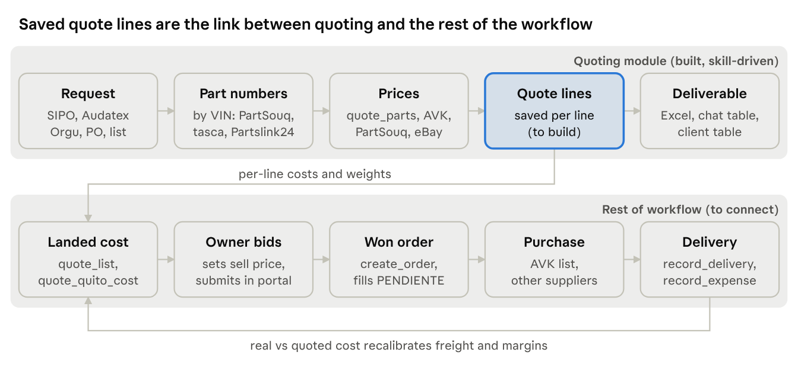

# Master Partes — Quoting Workflow Handover & Integration Map

Nov 24, 2026 · Live doc: https://claude.ai/artifact/8ARjJgJJLvjh2Nzr1pJdoY

## Purpose

The quoting module turns an insurer's parts request into correct OEM part numbers by VIN and supplier prices. It stops at prices: the owner decides the sell price and places the bid. Everything after a bid is won (order, purchase, import, delivery, expenses) belongs to the rest of the workflow, which this doc maps the connections to.

- **Method lives in two saved skills:** `masterpartes-cotizacion` (business rules, formats, sources, glossary) and `partsouq-vin-parts-lookup` (catalog lookup). Any agent should load the first one before quoting.
- **This doc covers what the skills do not:** how quoting connects to the other functions, the data each step should hand to the next, what is still manual, and the open cases.
- **Audience:** the instance integrating pricing with orders, Quito landed cost, deliveries and expenses.

## End-to-end flow

Quoting is built and runs from the skills; everything from landed cost onward exists as tools but is fed by hand.

The one missing piece is the saved quote line: once each line is stored, landed cost, won orders, purchases and deliveries can all read it instead of re-typing from Excel.

## Inputs

Five request types arrive, each with a fixed client tier and output format.

| Input | Arrives as | Client (tier) | Key fields | Output |
| --- | --- | --- | --- | --- |
| SIPO / CESVI auction | Email in Roundcube `INBOX.SIPO` (link with new `cpsess` each time) | Seguros Atlántida (B) | Clave, close date/time (Ecuador UTC−5), marca/línea/versión/modelo, VIN, parts + qty | Daily Excel `Cotizaciones_SIPO_<date>.xlsx` |
| Audatex request | JSON pasted in chat | Zurich (A), Latina (C), Chubb and others (B) | `cotizacion_id`, `vin`, `ano_modelo`, `armadora`, `partes[{parte, descripcion}]` (parte often wrong or an internal code) | Chat table, request order |
| Orgu Ford | WhatsApp image: number + description | Orgu (dealer) | Ford part numbers; owner gives sell price | Table "X + IVA", "20 días (importación)" |
| Won purchase order | SIPO email "Solicitud de Piezas" or screenshot "Orden De Compra Proveedor" | Insurer that awarded | Clave, VIN (may be corrupt), parts with reference or PENDIENTE, price, delivery date | Missing part numbers; then an order in the system |
| Direct client list | Photo of handwritten list + chassis plate | Workshop / end client | Part numbers (usually correct), qty | Price comparison, then client table genuine-only + IVA |

Also seen: the SIPO "Historial Subasta" popup (lines requested vs lines already offered), read by screenshot or pasted text.

## Sources and tools

Part numbers come from catalogs in the owner's Chrome; prices come from the `masterpartes` MCP plus the same browser.

**Catalogs (number by VIN)**

| Brand group | Catalog | Notes |
| --- | --- | --- |
| Toyota, Lexus, Nissan, Mitsubishi, Mazda, Hyundai/Kia, Subaru | PartSouq (`/en/search/all?q=<VIN>`) | Also gives non-US genuine price, stock and weight. No Honda US or Ford VINs |
| Ford US | tascaparts.com (VIN → trim page, categories) | Sale price + MSRP. Kuga EU (WF0) → use Escape US with ⚠ |
| European (PSA, Renault, VW, BMW, Mitsubishi EU) | Partslink24 (owner logs in) | Ford not licensed. Unknown VINs → Model Overview path |
| Mercedes US | mbpartsgiant category pages | Some EU numbers missing |
| Jeep / Mopar | moparpartsgiant (readable), store.mopar.com (blocked to fetch) | Supersession tables |
| Honda | none by VIN today | eBay description search to find numbers |

**Price tools in the `masterpartes` MCP (on the laptop)**

| Tool | Use in quoting |
| --- | --- |
| `quote_parts` | US OEM store price/MSRP by brand (ford, nissan, toyota, honda) + eBay genuine/aftermarket with shipping to Miami. `source="auvika"` = AVK (needs AVK worker) |
| `ebay_por_descripcion` | eBay by text when there is no number |
| `quote_list` / `quote_detail` / `quote_quito_cost` | Landed cost in Quito with margin by client tier (offered at the end, rarely run yet) |
| `estimate_part_weight`, `lookup_tariff` | Freight and duty inputs for landed cost |
| `buscar_numeros_vin` | VIN → numbers via Supabase catalog worker (down) |

**Browser-only sources:** AVK (avkparts.lt bulk search, € without VAT), PartSouq price pages, tascaparts, Partslink24. Cloudflare checks and logins are always done by the owner.

## Outputs and data contracts

Today the results live only in Excel files and chat; the integration needs them as records.

**Current outputs**

- **SIPO Excel:** one block per clave, sorted by close time. Columns: `# | Pieza (pedido) | Cant. | Número de parte | OEM (unit.) | MSRP | Fuente OEM | eBay OEM | eBay alterno | Total OEM | Notas`. EUR blocks for AVK; ⚠ notes in red; PENDIENTE where no number.
- **Audatex chat table:** `# | Pieza | Número correcto | Genuina | eBay OEM | eBay alterno`, request order, total genuine. European parts add AVK € and Vilnius→Miami freight.
- **Client table:** `# | Repuesto | N° parte | Cant. | Precio` with "+ IVA" per line, total, "Entrega: 20 días (importación)". No supplier costs.

**Proposed quote-line record (one per requested line)**

| Field | Example | Why it matters downstream |
| --- | --- | --- |
| `request_id` | SIPO clave 858604 / Audatex 6919 | Links bid → won order |
| `client`, `tier` | Atlántida, B | Margin in `quote_list` |
| `close_at` (Ecuador time) | 2026-11-23 16:12 −05:00 | Prioritise, skip closed |
| `vin`, `vehicle_decoded` | JN1JDNT33RW001127, X-Trail T33 e-POWER L4 | Re-use, fitment proof |
| `line_no`, `requested_text`, `qty` | 9, PUERTA DELANTERA IZQUIERDA, 1 | Keep request order |
| `part_number`, `interpretation_flag` | H010A-6RAMA, ⚠ | Order the right part |
| `source`, `currency`, `unit_cost`, `msrp` | PartSouq, USD, 698.61 | Landed cost |
| `ebay_genuine`, `ebay_aftermarket` | 140.00 / — | Alternate offer |
| `stock`, `lead_days`, `weight_kg` | 0, 15–20, 15.8 | Freight + delivery promise |
| `sell_price`, `discount`, `bid_status` | set by owner | Won/lost tracking |
| `quoted_at`, `quoted_by` | 2026-11-23, agent | Re-sent auctions reuse lines |

## Integration points

Quoting connects to the rest of the workflow at five hand-offs; today each one is a manual copy.

| Hand-off | From quoting | To (existing tool or step) | What to build |
| --- | --- | --- | --- |
| 1. Landed cost | Quote lines with `unit_cost`, `currency`, `source`, `weight_kg` | `quote_list` / `quote_quito_cost` (tier margin, freight, duty via `lookup_tariff`) | Run automatically per request; return a bid suggestion per line, genuine and alternate |
| 2. Bid record | Sell price chosen by owner per line | SIPO / Audatex portals (owner submits) | Store `sell_price` + `bid_status` on the line; never auto-submit |
| 3. Won order | "Solicitud de Piezas" / purchase order with clave | `create_order`, `find_orders` | Match clave → stored quote lines; fill PENDIENTE numbers; create the order with the quoted source |
| 4. Purchase | Order lines by source (AVK, PartSouq, US OEM, eBay) | `generate_avk_list`, supplier carts (owner pays) | Group by supplier and warehouse; AVK list in its bulk format `N1_N2_…` |
| 5. Delivery and costs | Delivered parts, real freight and duty | `record_delivery`, `record_expense` | Close the loop: real vs quoted cost per line, to recalibrate freight and margins |

Also useful: `get_excel_parts` can read the SIPO Excel back into lines, and `db_select` / `inspect_db` to check what is stored before quoting a re-sent clave.

## Business rules to centralize

These rules are written only in the skill today; they should live in one config the pricing tools read.

| Rule | Current value | Source |
| --- | --- | --- |
| Client tiers | Atlántida B · Zurich A · Latina C · Chubb and others B | Owner |
| Auction clock | Close times in Ecuador time (UTC−5); skip closed auctions | SIPO emails |
| AVK prices | € without VAT, cheapest warehouse; express 3–5 days costs ~4–15% more | avkparts.lt |
| Freight Vilnius → Miami | €6.33 per kg volumetric (L×W×H/5000). Examples: bumper €645.66, grille €296.24, headlamp €106.34, small box €81.02 | Owner |
| eBay prices | Include shipping to Miami; "genuine" under 40% of OEM = treat as used/mislabeled | Observed |
| Currencies | USD for US/PartSouq, EUR for AVK; never mix in one block | Owner |
| Client offer wording | "$X + IVA" per line; "Entrega: 20 días (importación)"; part numbers without spaces | Owner |
| Discounts | Applied per line on genuine price (e.g. 6.5%), only net shown | Owner, 24-nov |
| Safety | Owner logs in, passes Cloudflare, submits bids and pays; agents never do | Owner |

## Known gaps and fixes

Most time is lost to blocked sources and to state that is not saved between sessions.

| Gap | Effect | Fix |
| --- | --- | --- |
| `buscar_numeros_vin` down (paused Supabase) | All VIN decoding by hand in the browser | Restore the Supabase project; click "Catálogo worker" bookmark |
| AVK worker down | `quote_parts(source="auvika")` fails; Cloudflare click per search | Open avkparts.lt and click "AVK worker" bookmark |
| PartSouq 403 for the MCP | Non-US genuine prices only via browser | Price through the owner's Chrome, or a worker like AVK's |
| quote_parts for Mercedes / VW / BMW | No OEM price, only eBay | Add mbpartsgiant category parsing; AVK for EU |
| hondapartsnow blocked; Honda US VINs not in PartSouq | Honda numbers guessed from eBay titles | Another Honda catalog or a worker in the owner's browser |
| Quotes not persisted | Re-sent auctions re-quoted from scratch; notes lost when a session ends | Quote-line record (Outputs section) written on every quote |
| Laptop / Chrome disconnects mid-batch | Partial deliveries | Persist after each part; resume from stored lines |
| Freight per part estimated by hand | Bulky parts (doors, windshields) under- or over-priced | `estimate_part_weight` + PartSouq/AVK weights into `quote_quito_cost`; apply `supabase/migrations/009_envio_clase.sql` (shipping classes) |

## Open cases (as of 24-nov)

Seven cases are still open; the four SIPO auctions close on 25-nov.

| Case | Status | Waiting on |
| --- | --- | --- |
| SIPO 859107 RAV4 2014 — closes 25-nov 10:00 | Radiator 16400-28560 $577.79; lower hose 16572-37160 no OEM price | Owner bid |
| SIPO 858794 C3 Aircross — closes 25-nov 10:10 | Hood release 98 011 150 80 €21.61 (alt. YQ 000 531 80) | Photo to confirm variant |
| SIPO 857538 Escape/Kuga 2019 — closes 25-nov 10:12 | Lower protector GJ5Z-17D957-AA $328.81 (US number); ECU bracket GV6Z-12A659-A $46.54 | Photo; Kuga EU may differ |
| SIPO 859299 Montero Sport 2023 — closes 25-nov 1:48 PM | Windshield 6102BW090P $483.82; "visera" read as moulding 6107A096 | Meaning of "visera"; freight for glass |
| SIPO 859113 X-Trail T32 | Closed 24-nov; priced in chat ($347.12) | Two lines without number if re-auctioned |
| Mustang (Orgu) | Numbers verified | Owner's sell prices |
| Hilux 45210 | Pending | Full VIN or main vs intermediate shaft |

Older unresolved items: Forester non-US parts, CR-V deflector, GLA parts, Escape transmission, CX-5 858453 engine and maintenance list. Files: `Cotizaciones_SIPO_2026-11-23.xlsx` and `…-11-24.xlsx` in the outputs folder.
